# HomeNet Guardian

**A home-network dashboard for parents that needs nothing installed on the child's phone.**
It works only from what a home router already sees: which site names each device asks for, when, and how much. It never reads messages or page content.

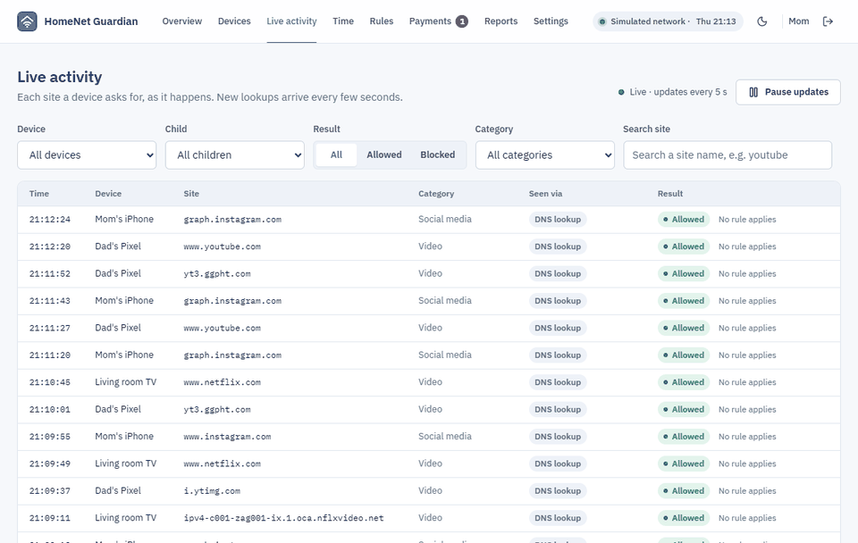

> **Status: showcase, not a product.** Everything runs on a **simulated** family network (Mom, Dad, Ana 14, Luka 9) on your own computer. No real router and no real family data. The pictures on this page come from a simulated Thursday. Weekly/monthly reports and the security review are still **in progress**.

## Why

Parental-control apps live on the child's device, where children find and remove them. On a home network every device already asks the router for site addresses (DNS). HomeNet Guardian turns that into a calm dashboard: who is online, what was blocked and why, bedtimes, and purchases that wait for a parent's OK. Because nothing is hidden on the child's device, the app asks the parent to tell the child first, and it has a page that says plainly what it **cannot** see.

## How it works

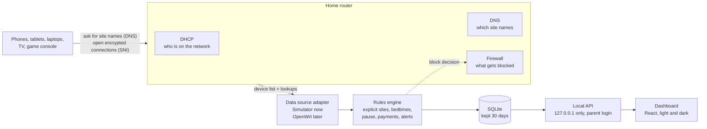

1. **Data source ("adapter").** The engine only asks two questions, the same two a router can answer: *which devices are here* (DHCP leases) and *which site names did they ask for* (DNS log, plus the site name visible at the start of an encrypted connection, SNI). Today a **simulator** answers them with a realistic family day; an **OpenWrt** adapter would answer them from the router's files (see below).
2. **Rules engine.** Every lookup gets a decision and a reason, checked in this order: explicit sites (always blocked) → known encrypted-DNS servers (blocked, they would hide lookups) → background system traffic (allowed) → pause → bedtime schedule → stores & payments (wait for a parent) → category rules → allowed.
3. **Alerts.** A new unknown device, an explicit site, night use, a payment request, and a device whose lookups suddenly stop reaching the router while it is still online (a sign of encrypted DNS or a VPN getting around the filter).
4. **Dashboard.** A local web app with parent login. Time spent is always shown as an **estimate** built from lookup bursts.

## The screens

| | |
|---|---|
| 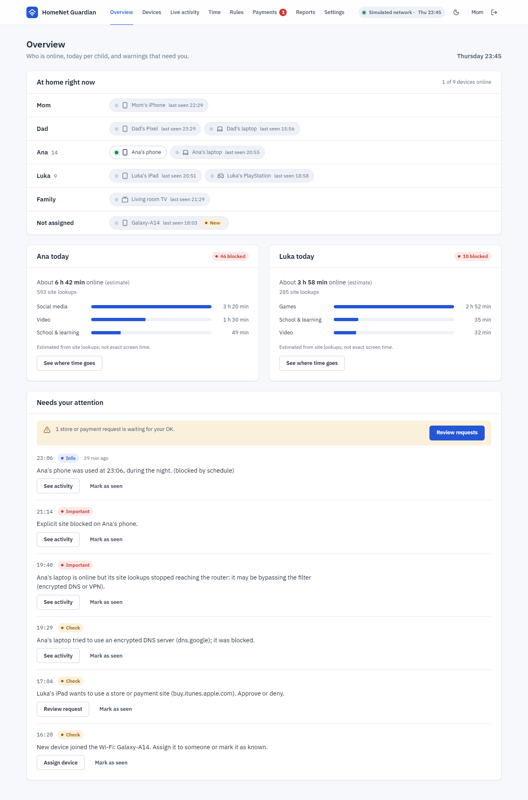 | **Overview.** "At home right now" shows each person's devices lit like router LEDs. Below: today per child (estimated time, lookups, blocked) and the warnings that need the parent, each with a one-click action. |
| 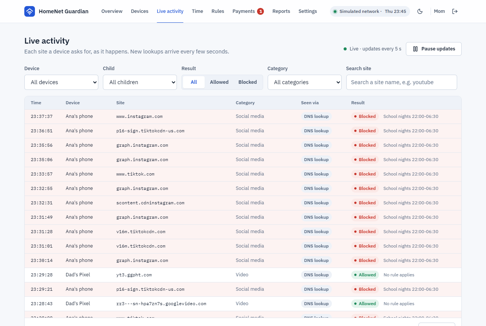 | **Live activity.** A Wireshark-style table of every lookup: time, device, site, category, how it was seen (DNS or SNI), and the decision with its reason. New rows arrive every few seconds. Here: Ana's phone during school-night hours. |
| 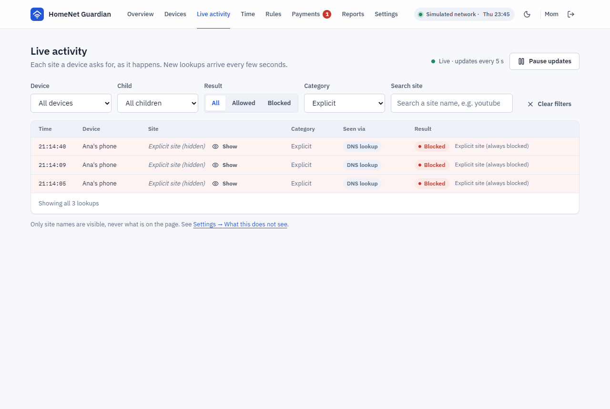 | **Explicit sites stay hidden.** The names of adult sites are not shown unless a parent clicks "Show". They are blocked for every device in the home. |
| 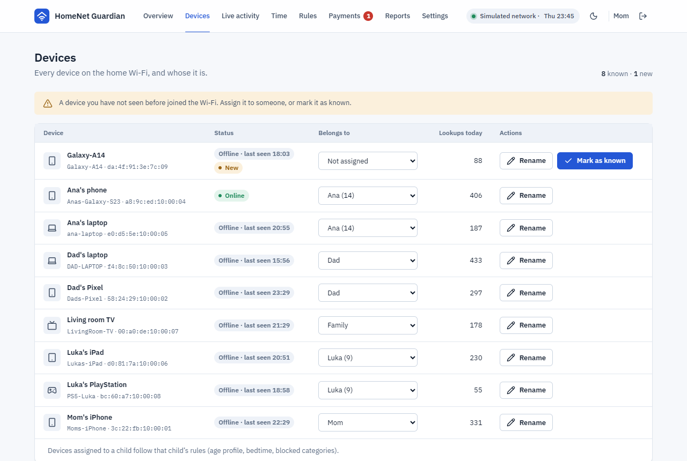 | **Devices.** Everything on the Wi-Fi. A visitor's phone shows up as "New"; assign devices to a child so that child's rules apply, and set each child's age profile (8 / 13 / 16). |
| 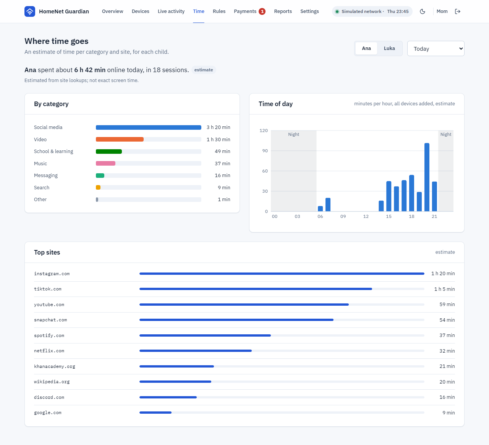 | **Where time goes.** Estimated time per category, a 24-hour chart with night hours shaded, and the top sites. Every number is labelled as an estimate. |
| 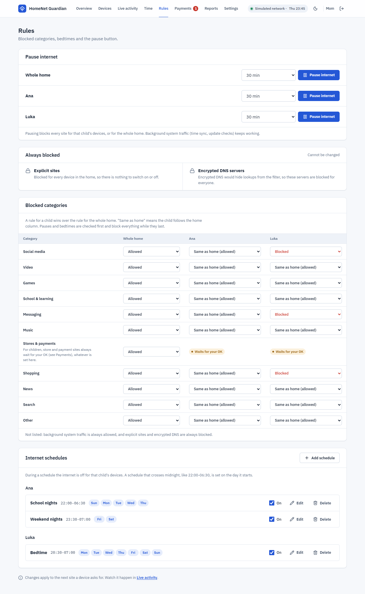 | **Rules.** A pause button per child or for the whole home, what is always blocked, category rules (a child's rule wins over the home rule) and bedtime schedules. |
| 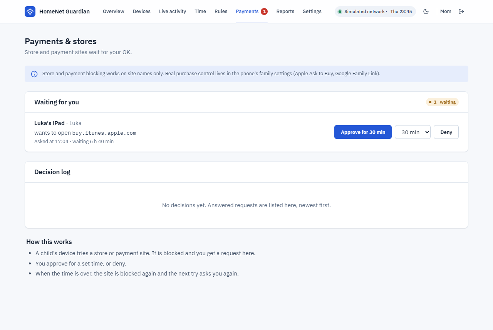 | **Payments & stores.** When a child's device tries an app store or payment site, it is blocked and the parent gets a request to approve for a set time or deny. The app says honestly that this works on site names only; real purchase control lives in the phone's family settings. |
| 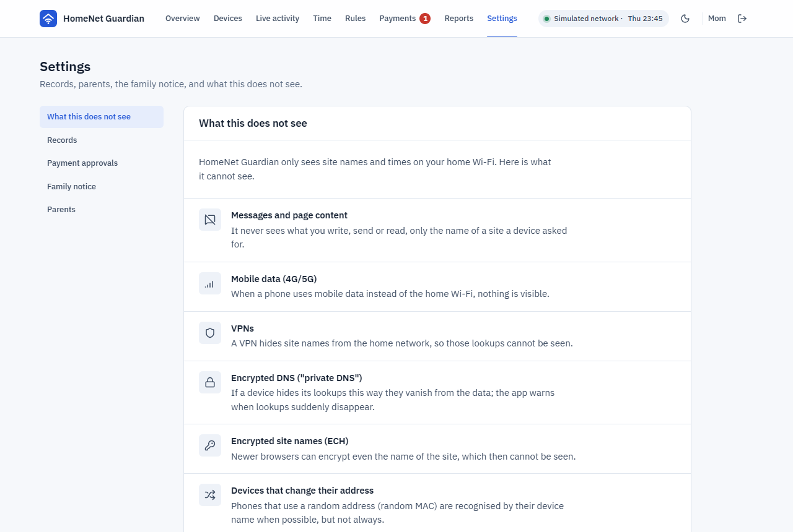 | **Settings.** Starts with *What this does not see*, then how long records are kept (30 days), "delete everything" (type DELETE to confirm), the family notice and the parent accounts. |

<details>
<summary>Dark theme, phone width and the login</summary>

| | | |
|---|---|---|
| 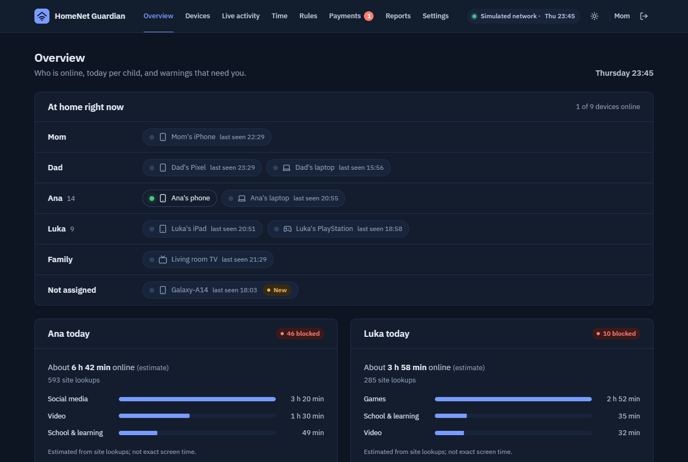 | 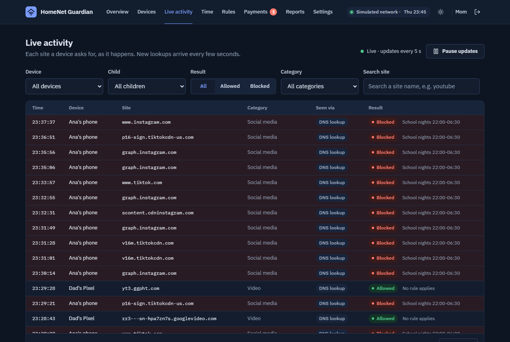 | 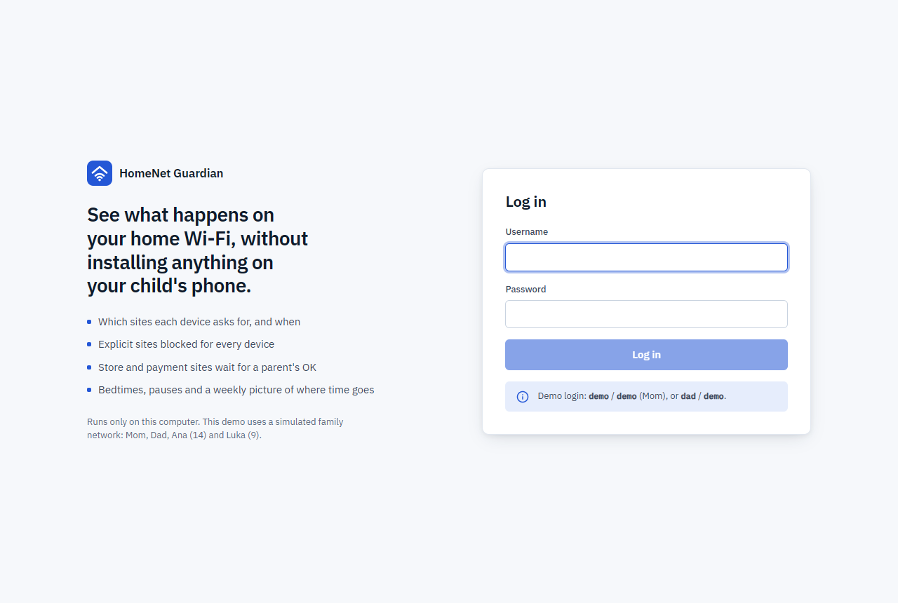 |
| 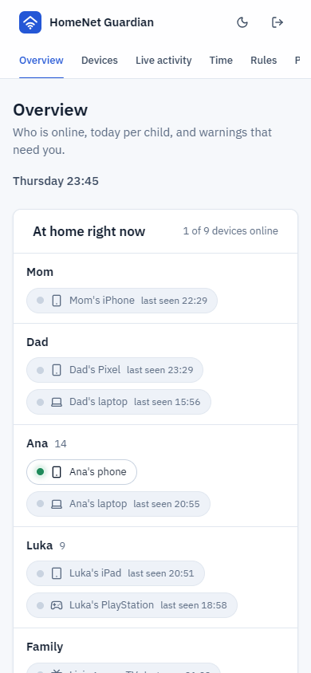 | 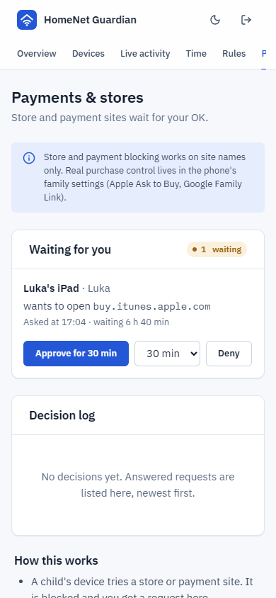 | 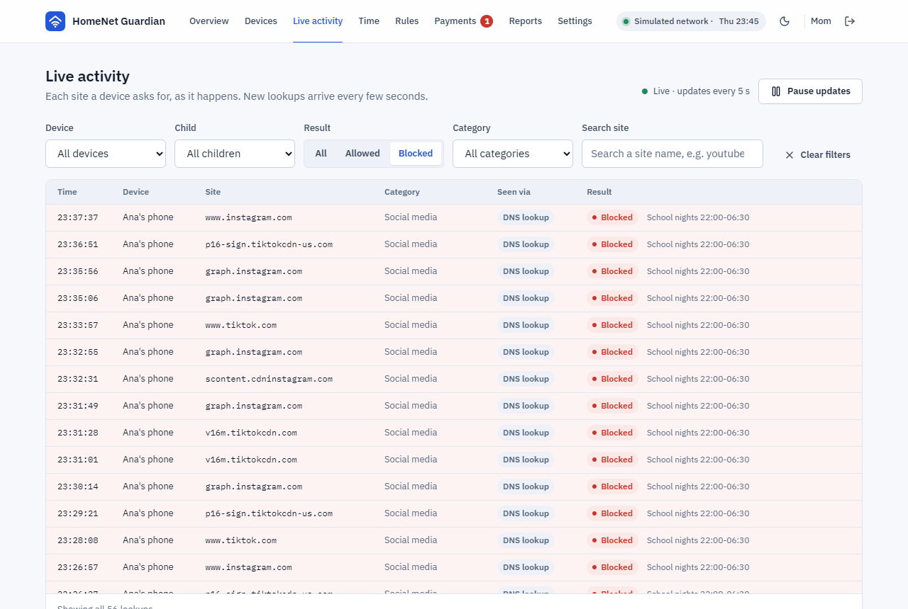 |

</details>

## What it does NOT see

- **Content.** Never messages, photos, passwords or what is on a page; only site names and times.
- **Mobile data.** When a phone uses 4G/5G instead of the home Wi-Fi, nothing is visible.
- **VPNs and encrypted DNS** ("private DNS" on Android). They hide lookups. The app blocks known encrypted-DNS servers and warns when a device's lookups vanish.
- **Encrypted site names (ECH)** in newer browsers.
- **Random device addresses.** New phones change their MAC address; the app recognises them by name when it can.
- **Exact screen time.** Time is an estimate from lookups; two devices used at once are added together.

## Connecting a real OpenWrt router (described, not built)

The OpenWrt adapter in [`backend/homenet/adapters/openwrt.py`](backend/homenet/adapters/openwrt.py) documents the plan and parses the router's file formats (tested on sample lines only, not on a real router):

- **Devices:** `/tmp/dhcp.leases`, written by dnsmasq (`expiry mac ip hostname client-id`).
- **Lookups:** dnsmasq with query logging (`uci set dhcp.@dnsmasq[0].logqueries='1'`), lines like `query[A] tiktok.com from 192.168.1.31`; the lease file maps the IP to the device.
- **Blocking:** dnsmasq answers blocked names with nothing, or fills an nftables set (`nftset=/tiktok.com/4#inet#fw4#hg_block`) that a firewall rule drops per device.
- **Stopping bypass:** redirect every DNS request (port 53) to the router and block known DNS-over-HTTPS / DNS-over-TLS servers; devices that still have traffic but stop sending lookups are flagged.

## Run it yourself

Needs Python 3.11 and Node 20+ (Windows commands shown).

```
npm run setup
npm run dev
```

Open http://127.0.0.1:5173 and log in with **demo / demo** (Mom) or **dad / demo**. The first screen asks you to confirm that the children were told. The simulated day follows your computer's clock, so evening moments (the explicit site at 21:14, night use after 23:00) appear in the evening.

```
npm test                        # 160 backend tests: rules, payments, alerts, login, clean-up
cd backend && .venv\Scripts\python -m homenet.demo   # prints a whole simulated day as text
```

## Built with

Python 3.11, FastAPI, SQLite · React 19, Vite, TypeScript, Recharts · IBM Plex fonts (bundled) · lucide icons.
Security basics: passwords stored as Argon2 hashes, HttpOnly SameSite=Strict session cookie, server reachable from this computer only, 5 wrong passwords lock the login for a minute, records deleted after 30 days.

## Credits and licence

- Explicit-site list: the MIT-licensed parts of [StevenBlack/hosts](https://github.com/StevenBlack/hosts) (Sinfonietta, Clefspeare13 pornhosts, BigDargon hostsVN). Details in [`backend/homenet/data/NOTICE.md`](backend/homenet/data/NOTICE.md).
- Site categories: our own list.
- Code: [MIT](LICENSE).
